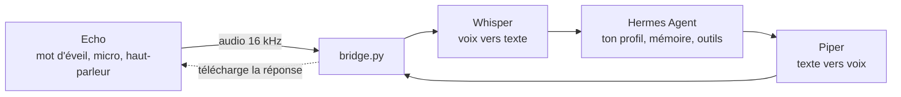

# Echo Hermes Bridge

[](https://github.com/Naod6473/echo-hermes-bridge/actions/workflows/ci.yml)
[](LICENSE)


Parler à [Hermes Agent](https://github.com/NousResearch/hermes-agent) à voix haute avec un vieil Amazon Echo, **sans Home Assistant**.

*[Read in English](README.md)*



Une fois flashé avec [echo-dot-assist](https://github.com/Gamer92000/echo-dot-assist), l'Echo se comporte comme un satellite vocal ESPHome. D'habitude, c'est Home Assistant qui s'y connecte. Ici, `bridge.py` prend sa place avec la même librairie (`aioesphomeapi`). L'Echo gère le mot d'éveil, le micro et le haut-parleur. Le script transcrit ce que tu dis (Whisper), l'envoie à Hermes et lit la réponse (Piper).

Hermes garde le fil de la conversation grâce à l'en-tête `X-Hermes-Session-Id`. Une nouvelle conversation démarre après 30 min sans parler.

**État :** fonctionne de bout en bout sur un Echo Dot 2 (RS03QR), avec Hermes dans un LXC Proxmox. Compte environ 1,5 s de transcription sur 4 cœurs, plus le temps de réponse du modèle d'Hermes.

## Ce qu'il te faut

- Un Echo compatible : Echo Dot 2 (RS03QR), Echo Dot 3 de 2018 (D9N29T) ou Echo 2 (XC56PY). Voir [la liste](https://github.com/Gamer92000/echo-dot-assist/blob/main/devices/MODELS.md). Le Dot 3 de 2019-2020 (C78MP8) **n'est pas** compatible.
- Un PC pour le flasher : Linux (une clé live suffit, ni VM ni WSL) ou Windows 10/11 sur Intel/AMD.
- Une machine toujours allumée pour le bridge : LXC ou VM Debian/Ubuntu, Raspberry Pi 4/5 ou PC, avec Python 3.11 ou plus. 2 cœurs et 2 Go de RAM suffisent avec `WHISPER_MODEL=small`, 4 cœurs c'est plus réactif.
- Hermes Agent, avec son serveur API joignable depuis cette machine.

## 1. Flasher l'Echo

Le flash peut bricker l'Echo. Ne le fais qu'avec un Echo que tu es prêt à perdre.

Suis le guide echo-dot-assist de ton modèle. Pour un Echo Dot 2 depuis Windows, lis d'abord [docs/flashing-echo-dot-2-windows.md](docs/flashing-echo-dot-2-windows.md) (en anglais) : il liste les blocages qu'on a rencontrés et comment les passer.

À la fin, l'Echo est sur ton Wi-Fi. **Donne-lui une IP fixe dans ta box.** Sa page de réglages est sur `http://<ip-echo>:28931/` (appuie sur le bouton action de l'Echo pour te connecter).

Ne connecte pas Home Assistant au même Echo : il n'accepte qu'un seul client vocal.

## 2. Préparer Hermes

Lance le serveur API du profil Hermes auquel tu veux parler, et note :

- son URL, par exemple `http://<hote-hermes>:8642/v1` (ou `/p/<profil>/v1`) ;
- sa clé `API_SERVER_KEY`.

Si le bridge tourne sur une autre machine, le serveur API doit écouter sur le réseau (`API_SERVER_HOST=0.0.0.0`) et pas seulement sur 127.0.0.1.

Un profil dédié à la voix, avec des réponses courtes et un raisonnement faible, répond plus vite. Le [guide de hermes-voice](https://github.com/majorminorlabs/hermes-voice/blob/main/docs/voice-profile.md) explique comment le créer.

## 3. Installer le bridge

Sur Debian/Ubuntu. Sous Proxmox, un LXC Debian 13 non privilégié avec 2 à 4 cœurs, 2 Go de RAM et 8 Go de disque convient bien (par exemple avec le [script Debian des community-scripts](https://community-scripts.github.io/ProxmoxVE/scripts?id=debian)), en pont sur ton réseau local.

```bash
sudo apt install -y git python3 python3-venv
sudo git clone https://github.com/Naod6473/echo-hermes-bridge /opt/echo-hermes-bridge
cd /opt/echo-hermes-bridge
python3 -m venv .venv
.venv/bin/pip install -r requirements.txt

# voix française pour Piper (environ 60 Mo)
mkdir -p voices && cd voices && ../.venv/bin/python -m piper.download_voices fr_FR-siwis-medium && cd ..

cp .env.example .env
nano .env
```

Dans `.env`, renseigne `ECHO_HOST`, `HERMES_URL`, `HERMES_API_KEY`, et pour le français :

```ini
LANGUAGE=fr
PIPER_VOICE=voices/fr_FR-siwis-medium.onnx
```

Teste le lien avec Hermes, sans l'Echo :

```bash
.venv/bin/python bridge.py --ask "Dis bonjour en une phrase"
```

Puis lance-le pour de vrai : `.venv/bin/python bridge.py -v`. Le premier démarrage télécharge le modèle Whisper (environ 500 Mo). Tu dois ensuite voir `connected to ...` puis `ready: say the wake word`.

### En service

```bash
sudo cp deploy/hermes-echo.service /etc/systemd/system/
sudo systemctl daemon-reload
sudo systemctl enable --now hermes-echo
journalctl -u hermes-echo -f
```

**Pare-feu :** l'Echo télécharge chaque réponse depuis le bridge sur le port `8765`. Autorise-le sur ton réseau local.

## 4. Choisir le mot d'éveil

Le moteur Amazon de l'Echo est bien plus fiable que microWakeWord. On conseille **Alexa** ou **Computer** (à ajouter avec *Download from Amazon*), puis `WAKE_WORD=computer` dans `.env`. Détails dans [docs/wake-word.md](docs/wake-word.md).

Sur la page de réglages, active aussi **End of request** sur *normal* : l'Echo détecte alors lui-même la fin de ta phrase.

## Dépannage

- **`--ask` échoue :** mauvaise `HERMES_URL` ou mauvaise clé, ou serveur API qui n'écoute que sur 127.0.0.1.
- **Pas de connexion à l'Echo :** vérifie son IP, et qu'aucun Home Assistant n'y est connecté.
- **L'Echo s'allume mais ne dit rien :** le port 8765 est bloqué, ou `PUBLIC_IP` est faux.
- **Tu te fais couper :** active *End of request* sur l'Echo, ou augmente `END_SILENCE`.

Tous les réglages sont décrits dans [le README anglais](README.md#settings-env) et dans `.env.example`.

## Crédits

Voir [NOTICE.md](NOTICE.md). Licence MIT, voir [LICENSE](LICENSE).
