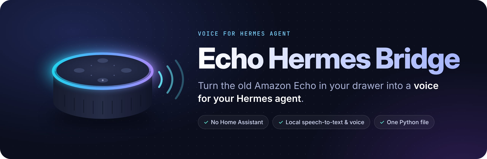
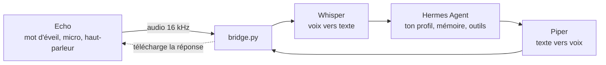
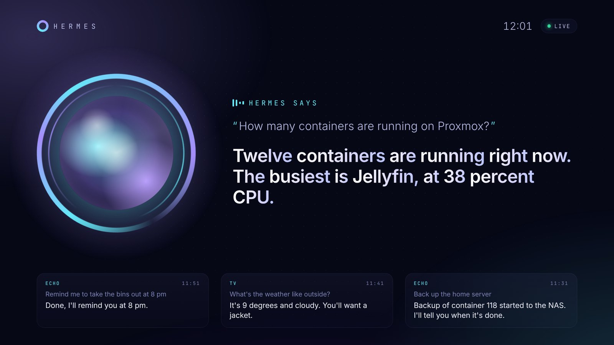
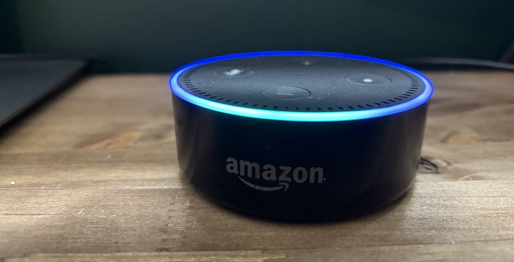

<p align="center">
  
</p>

<p align="center">
  <a href="https://github.com/Naod6473/echo-hermes-bridge/actions/workflows/ci.yml"></a>
  <a href="https://github.com/Naod6473/echo-hermes-bridge/releases"></a>
  <a href="LICENSE"></a>
  
  
</p>

<p align="center">
  <b>Parle à <a href="https://github.com/NousResearch/hermes-agent">Hermes Agent</a> à voix haute, avec un vieil Amazon Echo.</b><br>
  Un seul service Python. Pas de Home Assistant. La reconnaissance et la synthèse vocale tournent chez toi.
</p>

<p align="center">
  <a href="#-ce-que-tu-peux-en-faire">Cas d'usage</a> ·
  <a href="#-démarrage-rapide">Démarrage rapide</a> ·
  <a href="#-comment-ça-marche">Comment ça marche</a> ·
  <a href="#-installation-complète">Installation</a> ·
  <a href="#-faq">FAQ</a> ·
  <a href="README.md">English</a>
</p>

<div align="center">

https://github.com/user-attachments/assets/78d8778a-97a9-4797-a1c3-0ce6bffed2b3

<sub>🔊 Monte le son : un vrai Echo Dot 2 qui parle à Hermes.</sub>

</div>

---

## 💬 À quoi ça ressemble

```text
Toi     Computer, comment va le serveur Proxmox ?
        └─ compris en 1,6 s (Whisper small, 4 cœurs)
Hermes  Tout va bien : 12 conteneurs tournent, CPU à 9 %, disque rempli à 41 %.
        └─ répondu en 3,1 s, lu par l'Echo
Toi     Computer, redémarre le conteneur Jellyfin.
Hermes  C'est fait. Jellyfin est reparti et répond.
Toi     Computer, éteins les lumières du salon.
Hermes  Lumières du salon éteintes. Bonne nuit !
```

Hermes garde le fil de la conversation : les questions de suite marchent naturellement. Sa mémoire, ses outils et ses compétences sont là, parce que tu parles à *ton* agent, pas à un assistant générique.

*(Exemple d'échange. Temps mesurés sur l'installation de l'auteur ; les réponses d'Hermes dépendent des outils que tu lui donnes.)*

## 🎯 Ce que tu peux en faire

Tout ce qu'Hermes sait faire, tu peux maintenant le lui demander à voix haute, depuis le canapé, les mains prises, sans sortir ton téléphone ni ouvrir Hermes Desktop ou Hermes Web.

| | Dis par exemple... |
|---|---|
| 🖥️ **Piloter ton homelab** | *« Crée un conteneur Debian avec 2 cœurs pour Nextcloud. »* · *« Redémarre le conteneur Jellyfin. »* · *« Quelles VM consomment le plus de RAM ? »* · *« Fais un snapshot du conteneur DNS avant que je le mette à jour. »* |
| ⚙️ **Lancer des commandes** | *« Combien de place reste-t-il sur le NAS ? »* · *« Qu'est-ce qui a échoué dans la sauvegarde de cette nuit ? »* · *« Mets à jour les paquets du serveur multimédia. »* |
| 💡 **Commander la maison** | *« Éteins les lumières du salon. »* · *« Mets le chauffage à 19 degrés. »* · *« La porte du garage est fermée ? »* (via les outils ou intégrations que tu donnes à Hermes) |
| 🗓️ **Assistant du quotidien** | *« Qu'est-ce que j'ai demain ? »* · *« Rappelle-moi d'appeler le plombier à 17 h. »* · *« Résume mes mails non lus. »* |
| 🧠 **Réfléchir à voix haute** | *« Aide-moi à organiser le réseau du nouveau VLAN. »* · *« Retiens que le double des clés est chez le voisin. »* |

L'Echo devient un **terminal vocal mains libres pour ton agent** : tout ce qu'Hermes peut atteindre, ta voix peut l'atteindre.

> [!CAUTION]
> Toute personne à portée de voix peut parler à l'Echo. Ne donne au profil vocal que les outils que tu acceptes d'exposer ainsi, et garde une confirmation (ou un second facteur) pour les actions destructrices, comme supprimer un conteneur. Voir [SECURITY.md](SECURITY.md).

### Ensuite : une version portable

La version 1 recycle un Echo. L'objectif de la **version 2** est un petit satellite portable et pas cher, à base d'**ESP32** (par exemple un ESP32-S3 avec micro et haut-parleur), à poser dans n'importe quelle pièce ou à emporter, qui parle au même bridge et au même Hermes. Suis le repo (Watch ou ⭐) pour ne pas la rater.

## ✨ Pourquoi

- ♻️ **Une seconde vie pour un vieil Echo.** Des millions dorment dans des tiroirs. Flashé avec [echo-dot-assist](https://github.com/Gamer92000/echo-dot-assist), un Echo Dot 2 fait un excellent terminal vocal : micros longue portée, haut-parleur correct et anneau lumineux.
- 🧠 **Parle à ton propre agent.** Pas Alexa, pas un analyseur de commandes domotiques. Ton Hermes, avec sa mémoire, ses outils et sa personnalité.
- 🪶 **Minuscule.** Un fichier Python et un service systemd. Pas de Home Assistant, pas d'add-ons, pas besoin de Docker.
- 🏠 **Voix locale.** La transcription (faster-whisper) et la voix (Piper) tournent sur ta machine. Seul le texte part vers Hermes.
- 🌍 **Toutes les langues de Whisper.** Anglais et français intégrés, les autres en deux réglages.

> Tu as déjà Home Assistant ? Jette un œil à [hermes-voice](https://github.com/majorminorlabs/hermes-voice), qui a inspiré ce projet. Tu n'en veux pas ? Tu es au bon endroit.

## 🚀 Démarrage rapide

Tu as déjà un Echo flashé avec echo-dot-assist et un serveur API Hermes ? Choisis ta méthode. Chacune te demande l'IP de l'Echo, l'URL d'Hermes et sa clé.

**🐧 En une ligne, sur n'importe quel Debian / Ubuntu** (LXC, VM, Raspberry Pi) :

```bash
curl -fsSL https://raw.githubusercontent.com/Naod6473/echo-hermes-bridge/main/install.sh | sudo bash
```

**🧱 Proxmox VE : un LXC tout prêt.** À lancer dans le shell de l'hôte Proxmox. Le script affiche un récapitulatif et ne crée rien tant que tu n'as pas confirmé :

```bash
bash -c "$(curl -fsSL https://raw.githubusercontent.com/Naod6473/echo-hermes-bridge/main/deploy/proxmox-lxc.sh)"
```

**🐳 Docker :**

```bash
git clone https://github.com/Naod6473/echo-hermes-bridge && cd echo-hermes-bridge
cp .env.example .env && nano .env      # ECHO_HOST, HERMES_URL, HERMES_API_KEY, LANGUAGE=fr, PIPER_VOICE
docker compose up -d
```

Ensuite, dis le mot d'éveil et pose une question. Tu pars de zéro ? Suis l'[installation complète](#-installation-complète).

## 🔧 Comment ça marche



echo-dot-assist transforme l'Echo en **satellite vocal ESPHome**. D'habitude, c'est Home Assistant qui s'y connecte. Ici, `bridge.py` prend sa place, avec le même protocole et la même librairie (`aioesphomeapi`) :

1. L'Echo entend le mot d'éveil et envoie ta voix au bridge.
2. Le bridge repère la fin de ta phrase et la transcrit avec faster-whisper.
3. Il envoie le texte à l'API d'Hermes (compatible OpenAI) avec l'en-tête `X-Hermes-Session-Id`, pour qu'Hermes garde le fil. Une nouvelle conversation démarre après 30 min sans parler.
4. Il nettoie la réponse pour la voix (ni markdown, ni liens, ni emoji) et la transforme en WAV avec Piper.
5. L'Echo télécharge le WAV depuis le bridge et le lit.

## 📺 Sur ta TV

[](https://youtu.be/4oQY3ZKcexA)

▶️ **[Regarder la démo de 2 minutes sur YouTube](https://youtu.be/4oQY3ZKcexA)**

Ouvre `http://<bridge>:8765/screen/` dans le navigateur de n'importe quelle TV pour voir la conversation en direct, en plein écran, ou installe l'**appli Android** pour parler à Hermes : sur une TV avec le micro de la télécommande, sur un téléphone ou une tablette avec un bouton « toucher pour parler ». Avatar animé en option (ton propre dessin), en trois styles. Voir [docs/tv.fr.md](docs/tv.fr.md).

## 📦 Installation complète

### Ce qu'il te faut

| | |
|---|---|
| 🔊 **Un Echo** | Echo Dot 2 (RS03QR), Echo Dot 3 de 2018 (D9N29T) ou Echo 2 (XC56PY). Voir [la liste](https://github.com/Gamer92000/echo-dot-assist/blob/main/devices/MODELS.md). Le Dot 3 de 2019-2020 (C78MP8) **n'est pas** compatible. |
| 💻 **Un PC pour le flasher** | Linux (une clé live suffit, ni VM ni WSL) ou Windows 10/11 sur Intel/AMD. |
| 🖥️ **Une machine toujours allumée** | LXC ou VM Debian/Ubuntu, Raspberry Pi 4/5 ou PC, avec Python 3.11 ou plus. 2 cœurs et 2 Go de RAM suffisent, 4 cœurs c'est plus réactif. |
| 🤖 **Hermes Agent** | avec son serveur API joignable depuis cette machine. |

### 1. Flasher l'Echo

> [!WARNING]
> Le flash peut bricker l'Echo. Ne le fais qu'avec un Echo que tu es prêt à perdre.

Suis le guide echo-dot-assist de ton modèle. Pour un Echo Dot 2 depuis Windows, lis d'abord [nos notes](docs/flashing-echo-dot-2-windows.md) (en anglais) : elles couvrent tous les blocages qu'on a rencontrés et comment les passer.

À la fin, l'Echo est sur ton Wi-Fi. **Donne-lui une IP fixe dans ta box.** Sa page de réglages est sur `http://<ip-echo>:28931/` (appuie sur le bouton action de l'Echo pour te connecter).

<p align="center">
  <br>
  <sub>Un vrai Echo Dot 2, flashé avec echo-dot-assist, à l'écoute pour Hermes.</sub>
</p>

> [!IMPORTANT]
> Ne connecte pas Home Assistant au même Echo : il n'accepte qu'un seul client vocal.

### 2. Préparer Hermes

Lance le serveur API du profil Hermes auquel tu veux parler, et note son URL (par exemple `http://<hote-hermes>:8642/v1`, ou `/p/<profil>/v1`) et sa clé `API_SERVER_KEY`.

Si le bridge tourne sur une autre machine, le serveur API doit écouter sur le réseau (`API_SERVER_HOST=0.0.0.0`) et pas seulement sur 127.0.0.1.

> [!TIP]
> Un profil dédié à la voix, avec des réponses courtes et un raisonnement faible, répond nettement plus vite. Le [guide de hermes-voice](https://github.com/majorminorlabs/hermes-voice/blob/main/docs/voice-profile.md) explique comment le créer.

### 3. Installer le bridge

L'[installation en une ligne](#-démarrage-rapide) fait tout ce qui suit pour toi. Pour le faire à la main :

Sous Proxmox, un LXC Debian 13 non privilégié avec 2 à 4 cœurs, 2 Go de RAM et 8 Go de disque convient bien (par exemple avec le [script Debian des community-scripts](https://community-scripts.github.io/ProxmoxVE/scripts?id=debian)), en pont sur ton réseau local.

```bash
sudo apt install -y git python3 python3-venv
sudo git clone https://github.com/Naod6473/echo-hermes-bridge /opt/echo-hermes-bridge
cd /opt/echo-hermes-bridge
sudo python3 -m venv .venv
sudo .venv/bin/pip install -r requirements.txt

# voix française pour Piper (environ 60 Mo) ; écoute-les sur https://rhasspy.github.io/piper-samples/
sudo mkdir -p voices && cd voices && sudo ../.venv/bin/python -m piper.download_voices fr_FR-siwis-medium && cd ..

sudo cp .env.example .env
sudo nano .env
```

Dans `.env`, renseigne `ECHO_HOST`, `HERMES_URL`, `HERMES_API_KEY`, et pour le français :

```ini
LANGUAGE=fr
PIPER_VOICE=voices/fr_FR-siwis-medium.onnx
```

Teste le lien avec Hermes, sans l'Echo :

```bash
sudo .venv/bin/python bridge.py --ask "Dis bonjour en une phrase"
```

Puis lance-le pour de vrai avec `sudo .venv/bin/python bridge.py -v`. Le premier démarrage télécharge le modèle Whisper (environ 500 Mo). Tu dois ensuite voir `connected to ...` puis `ready: say the wake word`.

### 4. En service

```bash
sudo cp deploy/hermes-echo.service /etc/systemd/system/
sudo systemctl daemon-reload
sudo systemctl enable --now hermes-echo
journalctl -u hermes-echo -f
```

> [!NOTE]
> L'Echo télécharge chaque réponse depuis le bridge sur le port **8765**. Autorise-le sur ton réseau local si un pare-feu est actif.

### 5. Choisir le mot d'éveil

Le moteur Amazon de l'Echo est bien plus fiable que microWakeWord. On conseille **Alexa** ou **Computer** (à ajouter avec *Download from Amazon*), puis `WAKE_WORD=computer` dans `.env`. Tous les choix, y compris les modèles personnalisés, sont dans le [guide du mot d'éveil](docs/wake-word.md) (en anglais).

Sur la page de réglages, active aussi **End of request** sur *normal* : l'Echo repère alors lui-même la fin de ta phrase.

<details>
<summary><b>🩺 Dépannage</b></summary>

- **`--ask` échoue :** mauvaise `HERMES_URL` ou mauvaise clé, ou serveur API qui n'écoute que sur 127.0.0.1.
- **Pas de connexion à l'Echo :** vérifie son IP, et qu'aucun Home Assistant n'y est connecté.
- **L'Echo s'allume mais ne dit rien :** le port 8765 est bloqué, ou `PUBLIC_IP` est faux.
- **Tu te fais couper :** active *End of request* sur l'Echo, ou augmente `END_SILENCE`.
- **Il se réveille mal :** passe au moteur de mot d'éveil d'Amazon, voir le [guide](docs/wake-word.md).
- Lance `python bridge.py -v` et lis le log : il montre ce qui a été compris et ce qu'Hermes a répondu.

Tous les réglages sont décrits dans [le README anglais](README.md#-full-setup) et dans `.env.example`.
</details>

## ❓ FAQ

**Est-ce que quelque chose part chez Amazon ?**
Non. echo-dot-assist remplace le logiciel de l'Echo, qui ne parle plus à Amazon. Seule exception, facultative : télécharger une fois les mots d'éveil supplémentaires d'Amazon.

**Faut-il une carte graphique ?**
Non. Whisper `small` transcrit une phrase en 1,6 s environ sur 4 cœurs. Une carte graphique accélère encore.

**Plusieurs personnes peuvent l'utiliser ?**
Oui, mais elles partagent la même conversation et la même mémoire d'Hermes.

**Plusieurs Echo ?**
Lance un bridge par Echo, chacun avec son `--echo-host` et son `--http-port`.

**Je peux garder Alexa ?**
Non. Une fois flashé, l'Echo ne fait plus tourner l'assistant d'Amazon. « Alexa » peut rester le mot d'éveil.

**Je peux utiliser un autre LLM qu'Hermes ?**
Le bridge parle l'API chat completions d'OpenAI, donc tout serveur compatible devrait répondre. Il est conçu et testé pour Hermes Agent.

## 🗺️ Feuille de route

- [x] Conversations vocales avec Hermes, mémoire gardée d'un échange à l'autre
- [x] Mot d'éveil choisi dans `.env`
- [x] Anglais et français
- [ ] Réponse en streaming, pour que l'Echo commence à parler plus tôt
- [ ] Effets de l'anneau lumineux pendant qu'Hermes réfléchit
- [x] Installation en une ligne, script LXC Proxmox et image Docker
- [x] Écran TV et appli Android TV (appuyer et parler avec la télécommande), avatar animé
- [x] La même appli sur téléphone et tablette Android (toucher pour parler)
- [ ] Retours de propriétaires d'Echo Dot 3 et d'Echo 2
- [ ] **v2 : satellite portable sur ESP32** (ESP32-S3 + micro + haut-parleur)

Idées et retours bienvenus dans les [issues](https://github.com/Naod6473/echo-hermes-bridge/issues).

## 🙏 Crédits

Construit grâce à [echo-dot-assist](https://github.com/Gamer92000/echo-dot-assist), [hermes-voice](https://github.com/majorminorlabs/hermes-voice), [Hermes Agent](https://github.com/NousResearch/hermes-agent), [aioesphomeapi](https://github.com/esphome/aioesphomeapi), [faster-whisper](https://github.com/SYSTRAN/faster-whisper) et [Piper](https://github.com/OHF-Voice/piper1-gpl). Détails dans [NOTICE.md](NOTICE.md).

Licence MIT, voir [LICENSE](LICENSE). Sans lien avec Amazon, Nous Research ou Home Assistant.

<p align="center">
  <br>
  Si ce projet a redonné vie à ton vieil Echo, une ⭐ aide les autres à le trouver.
</p>
