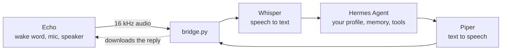

# Echo Hermes Bridge

[](https://github.com/Naod6473/echo-hermes-bridge/actions/workflows/ci.yml)
[](LICENSE)


Talk to [Hermes Agent](https://github.com/NousResearch/hermes-agent) out loud through an old Amazon Echo, **without Home Assistant**.

*[Lire en français](README.fr.md)*



Once flashed with [echo-dot-assist](https://github.com/Gamer92000/echo-dot-assist), an Echo behaves like an ESPHome voice satellite. Normally Home Assistant connects to it. Here `bridge.py` takes Home Assistant's place, using the same library (`aioesphomeapi`). The Echo handles the wake word, the microphone and the speaker. The bridge transcribes what you say, sends it to Hermes, and plays the answer back.

Hermes keeps the conversation through the `X-Hermes-Session-Id` header. A new conversation starts after 30 minutes of silence.

**Status:** works end to end on an Echo Dot 2 (RS03QR) with Hermes in a Proxmox LXC. Latency is about 1.5 s of speech-to-text on 4 CPU cores plus the time your Hermes model takes.

## What you need

- A supported Echo: Echo Dot 2 (RS03QR), Echo Dot 3 2018 (D9N29T) or Echo 2 (XC56PY). See the [echo-dot-assist model list](https://github.com/Gamer92000/echo-dot-assist/blob/main/devices/MODELS.md). The 2019-2020 Dot 3 (C78MP8) is **not** supported.
- A PC to flash it from: Linux (live USB is fine, no VM or WSL) or Windows 10/11 on Intel/AMD.
- An always-on machine for the bridge: Debian/Ubuntu LXC, VM, Raspberry Pi 4/5 or a PC, Python 3.10+. 2 CPU cores and 2 GB RAM is enough with `WHISPER_MODEL=small`; 4 cores is snappier.
- Hermes Agent with its API server reachable from that machine.

## 1. Flash the Echo

Flashing can brick the Echo. Only do it with one you are ready to lose.

Follow the echo-dot-assist guide for your model. If you flash an Echo Dot 2 from Windows, read [docs/flashing-echo-dot-2-windows.md](docs/flashing-echo-dot-2-windows.md) first: it lists the snags we hit and how to get past them.

When it is done, the Echo is on your Wi-Fi. **Give it a fixed IP in your router.** Its settings page is at `http://<echo-ip>:28931/` (press the Echo's action button to log in).

Do not connect Home Assistant to the same Echo: it accepts only one voice-assistant client.

## 2. Prepare Hermes

Start the API server of the Hermes profile you want to talk to and note:

- its URL, e.g. `http://<hermes-host>:8642/v1` (or `/p/<profile>/v1`);
- its `API_SERVER_KEY`.

If the bridge runs on another machine, make sure the API server listens on the network (`API_SERVER_HOST=0.0.0.0`), not only on 127.0.0.1.

A dedicated voice profile with short answers and low reasoning effort responds faster. The [hermes-voice guide](https://github.com/majorminorlabs/hermes-voice/blob/main/docs/voice-profile.md) explains how to make one.

## 3. Install the bridge

On Debian/Ubuntu. On Proxmox, an unprivileged Debian 13 LXC with 2 to 4 cores, 2 GB RAM and 8 GB disk works well (for example with the [community-scripts Debian LXC](https://community-scripts.github.io/ProxmoxVE/scripts?id=debian)), bridged on your LAN.

```bash
sudo apt install -y git python3 python3-venv
sudo git clone https://github.com/Naod6473/echo-hermes-bridge /opt/echo-hermes-bridge
cd /opt/echo-hermes-bridge
python3 -m venv .venv
.venv/bin/pip install -r requirements.txt

# a Piper voice (about 60 MB); pick one at https://rhasspy.github.io/piper-samples/
mkdir -p voices && cd voices && ../.venv/bin/python -m piper.download_voices en_US-lessac-medium && cd ..

cp .env.example .env
nano .env        # ECHO_HOST, HERMES_URL, HERMES_API_KEY, LANGUAGE, PIPER_VOICE
```

Check the link to Hermes without the Echo:

```bash
.venv/bin/python bridge.py --ask "Say hello in one sentence"
```

Then run it for real:

```bash
.venv/bin/python bridge.py -v
```

The first start downloads the Whisper model (`small`, about 500 MB). You should then see `connected to ...` and `ready: say the wake word`.

### Run it as a service

```bash
sudo cp deploy/hermes-echo.service /etc/systemd/system/
sudo systemctl daemon-reload
sudo systemctl enable --now hermes-echo
journalctl -u hermes-echo -f
```

**Firewall:** the Echo downloads each spoken reply from the bridge on port `8765`. Allow it on your LAN.

## 4. Choose a wake word

Amazon's own wake-word engine on the Echo is far more reliable than microWakeWord. We recommend **Alexa** or **Computer**. See [docs/wake-word.md](docs/wake-word.md).

On the Echo's settings page, also set **End of request** to *normal*: the Echo then detects the end of your sentence itself, better than the bridge does.

## Speaking another language

Set two things in `.env`:

```ini
LANGUAGE=fr
PIPER_VOICE=voices/fr_FR-siwis-medium.onnx
```

and download that voice (`python -m piper.download_voices fr_FR-siwis-medium`). English and French have built-in voice instructions and fallback messages. For other languages, set `VOICE_INSTRUCTION` and `FALLBACK_MESSAGE` yourself.

## Settings (`.env`)

| Variable | What it does |
|---|---|
| `ECHO_HOST` | the Echo's IP address |
| `HERMES_URL`, `HERMES_API_KEY` | your Hermes API server and its key |
| `LANGUAGE` | speech-to-text language, and the default instruction/fallback (`en`, `fr`...) |
| `WHISPER_MODEL` | `base` is faster (good on a Raspberry Pi), `small` is a good balance, `medium` is more accurate but slow without a GPU |
| `WHISPER_DEVICE=cuda`, `WHISPER_COMPUTE=float16` | if you have an NVIDIA GPU |
| `PIPER_VOICE` | path to the Piper `.onnx` voice |
| `WAKE_WORD` | wake word the bridge selects on the Echo at start (`alexa`, `computer`, `hey_jarvis`...). Empty leaves it as is |
| `END_SILENCE` | seconds of silence that end your sentence (0.8). Raise it if you get cut off |
| `IDLE_MINUTES` | minutes without talking before Hermes starts a new conversation |
| `VOICE_INSTRUCTION` | text added to each message (short spoken answers, no markdown) |
| `FALLBACK_MESSAGE` | what the Echo says when Hermes does not answer |
| `HTTP_PORT` | port the Echo downloads replies from (8765) |
| `PUBLIC_IP` | the bridge's LAN IP as the Echo sees it, if auto-detection picks the wrong one |

Every setting is also a command-line flag: `python bridge.py --help`.

## Troubleshooting

- **`--ask` fails:** wrong `HERMES_URL` or key, or the API server only listens on 127.0.0.1.
- **Cannot connect to the Echo:** check its IP, and that no Home Assistant instance is connected to it.
- **The Echo lights up but says nothing:** port 8765 is blocked, or `PUBLIC_IP` is wrong.
- **You get cut off mid-sentence:** turn on *End of request* on the Echo, or raise `END_SILENCE`.
- Run `python bridge.py -v` and read the log: it shows what was heard and what Hermes answered.

## Tests

```bash
.venv/bin/python tests/fake_echo_test.py
```

It runs the bridge against a fake Echo, a fake Hermes and fake speech models. It checks the message order, the wake word, end-of-speech detection, the headers sent to Hermes, the text cleanup and the WAV download.

## Files

| Path | What it is |
|---|---|
| `bridge.py` | the bridge (one file) |
| `cleanup.py` | turns Hermes' markdown into speakable text (from hermes-voice, MIT) |
| `.env.example` | every setting, commented |
| `deploy/hermes-echo.service` | systemd unit |
| `docs/` | flashing notes and wake-word guide |
| `tests/fake_echo_test.py` | end-to-end test with a fake Echo |

## Limits

- The reply is played once it is complete, not streamed.
- Hermes' memory is shared by everyone who talks to the Echo.
- One Echo per bridge. With several Echos, run one bridge per Echo, each with its own `--echo-host` and `--http-port` flags.

## Credits

See [NOTICE.md](NOTICE.md). MIT licence, see [LICENSE](LICENSE).
