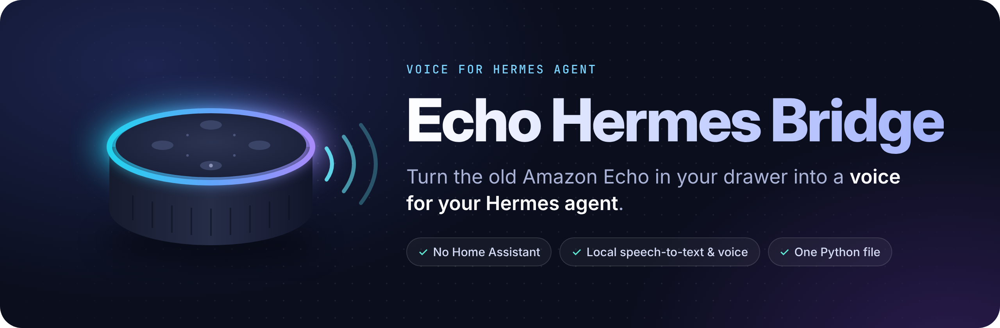
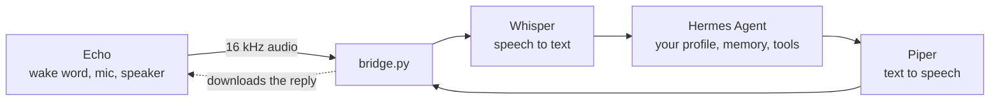
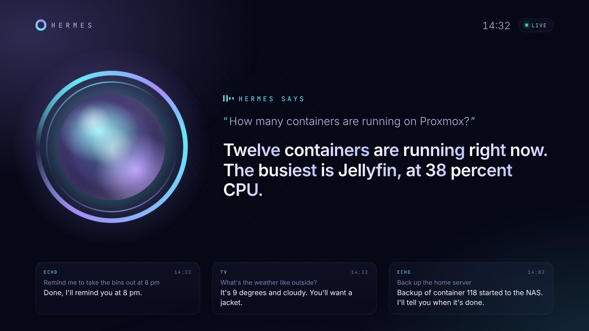
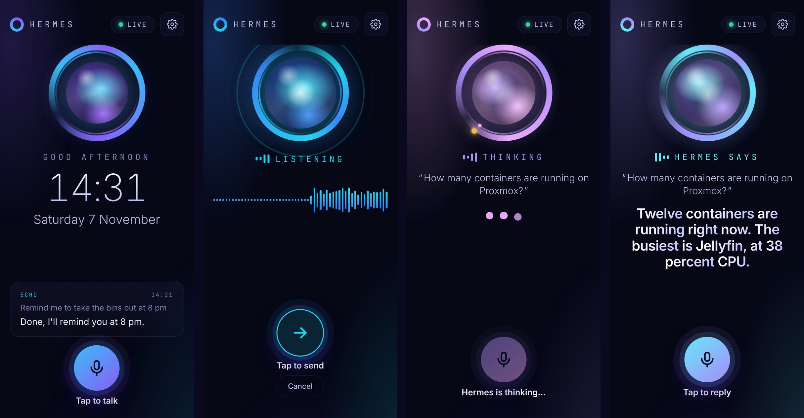
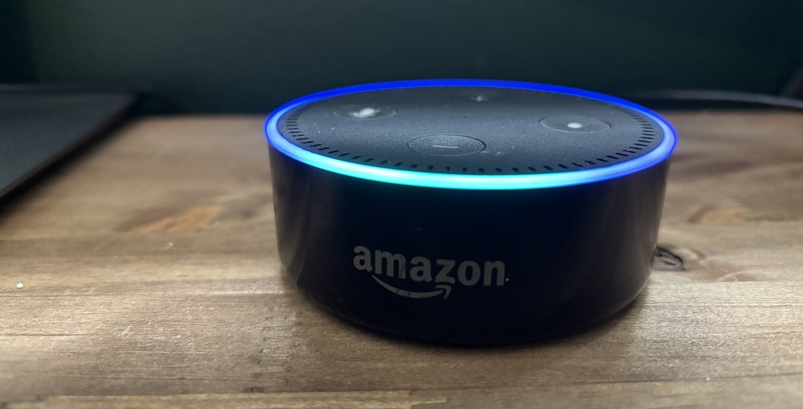

<p align="center">
  
</p>

<p align="center">
  <a href="https://github.com/Naod6473/echo-hermes-bridge/actions/workflows/ci.yml"></a>
  <a href="https://github.com/Naod6473/echo-hermes-bridge/releases"></a>
  <a href="LICENSE"></a>
  
  
</p>

<p align="center">
  <b>Talk to <a href="https://github.com/NousResearch/hermes-agent">Hermes Agent</a> out loud, through an old Amazon Echo.</b><br>
  One Python service. No Home Assistant. Speech recognition and voice run on your own machine.
</p>

<p align="center">
  <a href="#-what-you-can-do-with-it">Use cases</a> ·
  <a href="#-quick-start">Quick start</a> ·
  <a href="#-how-it-works">How it works</a> ·
  <a href="#-full-setup">Full setup</a> ·
  <a href="#-faq">FAQ</a> ·
  <a href="README.fr.md">Français</a>
</p>

<div align="center">

https://github.com/user-attachments/assets/78d8778a-97a9-4797-a1c3-0ce6bffed2b3

<sub>🔊 Sound on: a real Echo Dot 2 talking to Hermes.</sub>

</div>

---

## 💬 What it sounds like

```text
You     Computer, how is the Proxmox server doing?
        └─ heard in 1.6 s (Whisper small, 4 CPU cores)
Hermes  All good: 12 containers running, CPU at 9 %, 41 % of the disk used.
        └─ answered in 3.1 s, spoken by the Echo
You     Computer, restart the Jellyfin container.
Hermes  Done. Jellyfin is back up and answering.
You     Computer, turn off the living room lights.
Hermes  Living room lights off. Good night!
```

Hermes remembers the conversation, so follow-ups just work. Its memory, tools and skills are all there, because you are talking to *your* agent, not a generic assistant.

*(Example exchange. Timings measured on the author's setup; Hermes' answers depend on the tools you gave it.)*

## 🎯 What you can do with it

If Hermes can do it, you can now ask for it out loud, from the couch, hands full, without unlocking a phone or opening Hermes Desktop or Hermes Web.

| | Say something like... |
|---|---|
| 🖥️ **Run your homelab** | *"Create a Debian container with 2 cores for Nextcloud."* · *"Restart the Jellyfin container."* · *"Which VMs are using the most RAM?"* · *"Take a snapshot of the DNS container before I update it."* |
| ⚙️ **Run commands for you** | *"How much space is left on the NAS?"* · *"Show me what failed in last night's backup."* · *"Update the packages on the media server."* |
| 💡 **Drive your smart home** | *"Turn off the living room lights."* · *"Set the heating to 19 degrees."* · *"Is the garage door closed?"* (through the tools or integrations you give Hermes) |
| 🗓️ **Everyday assistant** | *"What's on my agenda tomorrow?"* · *"Remind me to call the plumber at 5."* · *"Summarise my unread emails."* |
| 🧠 **Think out loud** | *"Help me plan the network for the new VLAN."* · *"Remember that the spare key is with the neighbour."* |

The Echo becomes a **hands-free voice terminal for your agent**: what Hermes can reach, your voice can reach.

> [!CAUTION]
> Anyone in earshot can talk to the Echo. Give the voice profile only the tools you are happy to expose that way, and keep a confirmation step (or a second factor) for destructive actions such as deleting containers. See [SECURITY.md](SECURITY.md).

### Next: a portable version

Version 1 recycles an Echo. The goal for **version 2** is a small, cheap, portable satellite based on an **ESP32** (such as an ESP32-S3 with a microphone and a speaker) that you can put in any room or carry around, still talking to the same bridge and the same Hermes. Watch or star the repo to follow it.

## ✨ Why

- ♻️ **Give an old Echo a second life.** Millions of them sit in drawers. Flashed with [echo-dot-assist](https://github.com/Gamer92000/echo-dot-assist), an Echo Dot 2 makes a great voice terminal: far-field mics, a decent speaker and a light ring.
- 🧠 **Talk to your own agent.** Not Alexa, not a smart-home intent parser. Your Hermes, with its memory, its tools and its personality.
- 🪶 **Tiny.** One Python file and one systemd service. No Home Assistant, no add-ons, no Docker required.
- 🏠 **Local voice.** Speech-to-text (faster-whisper) and text-to-speech (Piper) run on your machine. Only the text goes to Hermes.
- 🌍 **Any language Whisper speaks.** English and French are built in, others take two settings.

> Already running Home Assistant? Have a look at [hermes-voice](https://github.com/majorminorlabs/hermes-voice), which inspired this project. Don't want Home Assistant? You're in the right place.

## 🚀 Quick start

Already have an Echo flashed with echo-dot-assist and a Hermes API server? Pick your flavour. Each one asks for your Echo's IP, your Hermes URL and its key.

**🐧 One line, on any Debian / Ubuntu box** (LXC, VM, Raspberry Pi):

```bash
curl -fsSL https://raw.githubusercontent.com/Naod6473/echo-hermes-bridge/main/install.sh | sudo bash
```

**🧱 Proxmox VE: a ready-made LXC.** Run this in the Proxmox host shell. It shows a summary and creates nothing until you confirm:

```bash
bash -c "$(curl -fsSL https://raw.githubusercontent.com/Naod6473/echo-hermes-bridge/main/deploy/proxmox-lxc.sh)"
```

**🐳 Docker:**

```bash
git clone https://github.com/Naod6473/echo-hermes-bridge && cd echo-hermes-bridge
cp .env.example .env && nano .env      # ECHO_HOST, HERMES_URL, HERMES_API_KEY
docker compose up -d
```

Then say the wake word and ask something. Starting from scratch? Follow the [full setup](#-full-setup).

## 🔧 How it works



echo-dot-assist turns the Echo into an **ESPHome voice satellite**. Normally Home Assistant connects to it. Here `bridge.py` takes Home Assistant's place, speaking the same protocol with the same library (`aioesphomeapi`):

1. The Echo hears the wake word and streams your voice to the bridge.
2. The bridge spots the end of your sentence and transcribes it with faster-whisper.
3. It sends the text to Hermes' OpenAI-compatible API with an `X-Hermes-Session-Id` header, so Hermes keeps the thread. A new conversation starts after 30 minutes of silence.
4. It cleans the reply for speech (no markdown, links or emoji) and turns it into a WAV with Piper.
5. The Echo downloads the WAV from the bridge and plays it.

## 📺 On your TV

[](https://youtu.be/4oQY3ZKcexA)

▶️ **[Watch the 2-minute demo on YouTube](https://youtu.be/4oQY3ZKcexA)** (French audio, English captions).

Open `http://<bridge>:8765/screen/` in any TV browser for a live, full-screen view of the conversation, or install the **Android app** to talk to Hermes: on a TV with the remote's microphone, on a phone or tablet with a tap-to-talk button. Optional animated avatar (your own drawing) in three styles. See [docs/tv.md](docs/tv.md).

<p align="center">
  
</p>

## 📦 Full setup

### What you need

| | |
|---|---|
| 🔊 **An Echo** | Echo Dot 2 (RS03QR), Echo Dot 3 2018 (D9N29T) or Echo 2 (XC56PY). See the [model list](https://github.com/Gamer92000/echo-dot-assist/blob/main/devices/MODELS.md). The 2019-2020 Dot 3 (C78MP8) is **not** supported. |
| 💻 **A PC to flash it** | Linux (a live USB is fine, no VM or WSL) or Windows 10/11 on Intel/AMD. |
| 🖥️ **An always-on box** | Debian/Ubuntu LXC or VM, Raspberry Pi 4/5 or any PC with Python 3.11+. 2 cores and 2 GB RAM are enough, 4 cores feel snappier. |
| 🤖 **Hermes Agent** | with its API server reachable from that box. |

### 1. Flash the Echo

> [!WARNING]
> Flashing can brick the Echo. Only do it with one you are ready to lose.

Follow the echo-dot-assist guide for your model. Flashing an Echo Dot 2 from Windows? Read [our notes](docs/flashing-echo-dot-2-windows.md) first: they cover every snag we hit and how to get past it.

When it is done, the Echo is on your Wi-Fi. **Give it a fixed IP in your router.** Its settings page is at `http://<echo-ip>:28931/` (press the Echo's action button to log in).

<p align="center">
  <br>
  <sub>A real Echo Dot 2, flashed with echo-dot-assist and listening for Hermes.</sub>
</p>

> [!IMPORTANT]
> Don't connect Home Assistant to the same Echo: it accepts only one voice-assistant client.

### 2. Prepare Hermes

Start the API server of the Hermes profile you want to talk to, and note its URL (e.g. `http://<hermes-host>:8642/v1`, or `/p/<profile>/v1`) and its `API_SERVER_KEY`.

If the bridge runs on another machine, the API server must listen on the network (`API_SERVER_HOST=0.0.0.0`), not only on 127.0.0.1.

> [!TIP]
> A dedicated voice profile with short answers and low reasoning effort replies noticeably faster. The [hermes-voice guide](https://github.com/majorminorlabs/hermes-voice/blob/main/docs/voice-profile.md) shows how to make one.

### 3. Install the bridge

The [one-line installer](#-quick-start) does everything below for you. To do it by hand:

On Proxmox, an unprivileged Debian 13 LXC with 2 to 4 cores, 2 GB RAM and 8 GB disk works well (for example the [community-scripts Debian LXC](https://community-scripts.github.io/ProxmoxVE/scripts?id=debian)), bridged on your LAN.

```bash
sudo apt install -y git python3 python3-venv
sudo git clone https://github.com/Naod6473/echo-hermes-bridge /opt/echo-hermes-bridge
cd /opt/echo-hermes-bridge
sudo python3 -m venv .venv
sudo .venv/bin/pip install -r requirements.txt

# a Piper voice (about 60 MB); hear them at https://rhasspy.github.io/piper-samples/
sudo mkdir -p voices && cd voices && sudo ../.venv/bin/python -m piper.download_voices en_US-lessac-medium && cd ..

sudo cp .env.example .env
sudo nano .env        # ECHO_HOST, HERMES_URL, HERMES_API_KEY, LANGUAGE, PIPER_VOICE
```

Check the link to Hermes, without the Echo:

```bash
sudo .venv/bin/python bridge.py --ask "Say hello in one sentence"
```

Then run it for real with `sudo .venv/bin/python bridge.py -v`. The first start downloads the Whisper model (`small`, about 500 MB). You should then see `connected to ...` and `ready: say the wake word`.

### 4. Run it as a service

```bash
sudo cp deploy/hermes-echo.service /etc/systemd/system/
sudo systemctl daemon-reload
sudo systemctl enable --now hermes-echo
journalctl -u hermes-echo -f
```

> [!NOTE]
> The Echo downloads each spoken reply from the bridge on port **8765**. Allow it on your LAN if a firewall is on.

### 5. Pick a wake word

Amazon's own wake-word engine on the Echo is far more reliable than microWakeWord. We recommend **Alexa** or **Computer**, then `WAKE_WORD=computer` in `.env`. The [wake-word guide](docs/wake-word.md) covers every option, including custom models.

On the Echo's settings page, also set **End of request** to *normal*: the Echo then spots the end of your sentence itself.

### Speak another language

```ini
LANGUAGE=fr
PIPER_VOICE=voices/fr_FR-siwis-medium.onnx
```

Download that voice with `python -m piper.download_voices fr_FR-siwis-medium`. English and French have built-in voice instructions and fallback messages. For other languages, also set `VOICE_INSTRUCTION` and `FALLBACK_MESSAGE`.

<details>
<summary><b>⚙️ All settings (<code>.env</code>)</b></summary>

| Variable | What it does |
|---|---|
| `ECHO_HOST` | the Echo's IP address |
| `HERMES_URL`, `HERMES_API_KEY` | your Hermes API server and its key |
| `LANGUAGE` | speech-to-text language, and the default instruction/fallback (`en`, `fr`...) |
| `WHISPER_MODEL` | `base` is faster (good on a Raspberry Pi), `small` is a good balance, `medium` is more accurate but slow without a GPU |
| `WHISPER_DEVICE=cuda`, `WHISPER_COMPUTE=float16` | if you have an NVIDIA GPU |
| `PIPER_VOICE` | path to the Piper `.onnx` voice |
| `WAKE_WORD` | wake word the bridge selects on the Echo at start (`alexa`, `computer`, `hey_jarvis`...). Empty leaves it as is |
| `END_SILENCE` | seconds of silence that end your sentence (0.8). Raise it if you get cut off |
| `IDLE_MINUTES` | minutes without talking before Hermes starts a new conversation |
| `VOICE_INSTRUCTION` | text added to each message (short spoken answers, no markdown) |
| `FALLBACK_MESSAGE` | what the Echo says when Hermes does not answer |
| `HTTP_PORT` | port the Echo downloads replies from (8765) |
| `PUBLIC_IP` | the bridge's LAN IP as the Echo sees it, if auto-detection picks the wrong one |

Every setting is also a command-line flag: `python bridge.py --help`.
</details>

<details>
<summary><b>🩺 Troubleshooting</b></summary>

- **`--ask` fails:** wrong `HERMES_URL` or key, or the API server only listens on 127.0.0.1.
- **Cannot connect to the Echo:** check its IP, and that no Home Assistant instance is connected to it.
- **The Echo lights up but says nothing:** port 8765 is blocked, or `PUBLIC_IP` is wrong.
- **You get cut off mid-sentence:** turn on *End of request* on the Echo, or raise `END_SILENCE`.
- **It rarely wakes up:** switch to Amazon's wake-word engine, see the [wake-word guide](docs/wake-word.md).
- Run `python bridge.py -v` and read the log: it shows what was heard and what Hermes answered.
</details>

## ❓ FAQ

**Does anything go to Amazon?**
No. echo-dot-assist replaces the Echo's software, the Echo no longer talks to Amazon. The only optional exception is downloading Amazon's extra wake words once.

**Does it need a GPU?**
No. Whisper `small` transcribes a sentence in about 1.6 s on 4 CPU cores. A GPU makes it faster.

**Can several people use it?**
Yes, but they share one Hermes conversation and memory.

**Several Echos?**
Run one bridge per Echo, each with its own `--echo-host` and `--http-port`.

**Can I keep Alexa?**
No. Once flashed, the Echo no longer runs Amazon's assistant. "Alexa" can still be the wake word.

**Can I use another LLM instead of Hermes?**
The bridge speaks the OpenAI chat completions API, so any compatible server should answer. It is built and tested for Hermes Agent.

## 🗺️ Roadmap

- [x] Voice conversations with Hermes, memory kept across turns
- [x] Wake word chosen from `.env`
- [x] English and French
- [ ] Stream the reply so the Echo starts talking sooner
- [ ] Light ring effects while Hermes is thinking
- [x] One-line installer, Proxmox LXC script and Docker image
- [x] TV screen and Android TV app (push-to-talk with the remote), animated avatar
- [x] The same app on Android phones and tablets (tap to talk)
- [ ] Reports from Echo Dot 3 and Echo 2 owners
- [ ] **v2: portable ESP32 satellite** (ESP32-S3 + mic + speaker)

Ideas and reports are welcome in the [issues](https://github.com/Naod6473/echo-hermes-bridge/issues).

## 🤝 Contributing

Pull requests are welcome. See [CONTRIBUTING.md](CONTRIBUTING.md): the tests run without any hardware, thanks to a fake Echo.

```bash
.venv/bin/python tests/fake_echo_test.py
```

## 🙏 Credits

Built on the shoulders of [echo-dot-assist](https://github.com/Gamer92000/echo-dot-assist), [hermes-voice](https://github.com/majorminorlabs/hermes-voice), [Hermes Agent](https://github.com/NousResearch/hermes-agent), [aioesphomeapi](https://github.com/esphome/aioesphomeapi), [faster-whisper](https://github.com/SYSTRAN/faster-whisper) and [Piper](https://github.com/OHF-Voice/piper1-gpl). Details in [NOTICE.md](NOTICE.md).

MIT licence, see [LICENSE](LICENSE). Not affiliated with Amazon, Nous Research or Home Assistant.

<p align="center">
  <br>
  If this gave your old Echo a second life, a ⭐ helps others find it.
  <br><br>
  <a href="https://star-history.com/#Naod6473/echo-hermes-bridge&Date">
    
  </a>
</p>
