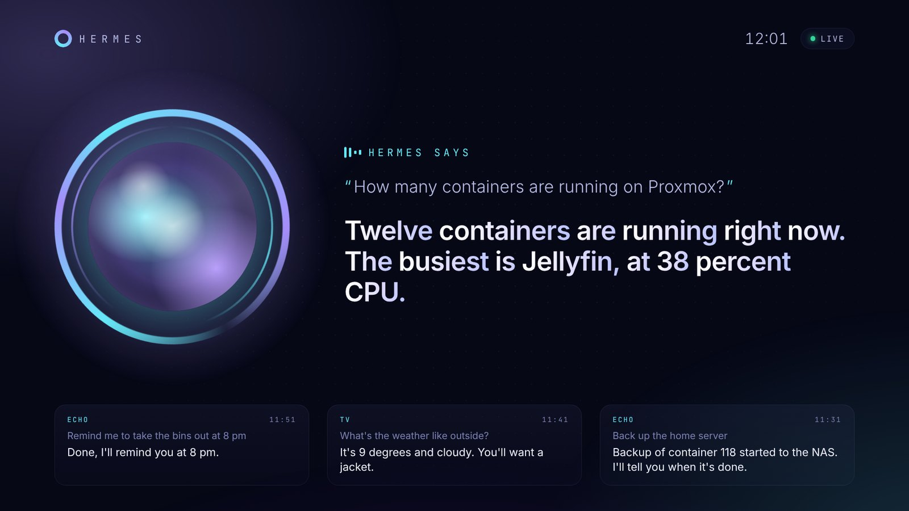

# Hermes sur ta TV

*[English version](tv.md)*



Deux façons d'amener Hermes sur la TV du salon. Les deux sont servies par le même `bridge.py`.

| | Ce que ça fait | Il faut |
|---|---|---|
| **Écran TV** | Une vue plein écran en direct : Hermes qui écoute, réfléchit, sa réponse mot par mot, les derniers échanges, et une horloge au repos. Affiche aussi les conversations de l'Echo. | N'importe quelle TV ou navigateur |
| **Appli Android TV** | Le même écran, plus **appuyer et parler avec la télécommande** : OK (ou le bouton micro), tu parles, Hermes répond par les haut-parleurs de la TV. | Android TV / Google TV (intégrée, ou un boîtier Google TV en HDMI) |

## Écran TV (toute TV)

Ouvre cette adresse dans le navigateur de la TV (ou d'un Fire TV, d'une tablette, d'un écran qui traîne) :

```
http://<IP du bridge>:8765/screen/
```

Options, à ajouter à l'adresse :

| Option | Effet |
|---|---|
| `?lang=fr` / `?lang=en` | Langue de l'interface (par défaut : celle du navigateur) |
| `&wake=Computer` | Le mot d'éveil affiché au repos |
| `&name=Simon` | « Bonsoir, Simon » |
| `&audio=1` | Dit aussi les réponses sur cet écran (un clic pour autoriser le son) |
| `&demo=1` | Boucle de démo sans bridge, pour voir le rendu |
| `&avatar=medallion` | Style d'avatar : `orb` (par défaut), `medallion`, `spectrum` ou `hologram` (voir plus bas) |
| `&ink=black` | Dessin à l'encre noire sur un disque clair, au lieu de l'encre blanche |

La page ne fait que lire le flux en direct (`/events`) : elle ne peut rien envoyer à Hermes.

## Ton propre avatar animé

À la place de l'orbe, l'écran peut afficher un portrait qui cligne des yeux, bouge les lèvres sur la voix, grandit quand Hermes parle et envoie des ondes sonores. Trois styles :

- **Médaillon** : le portrait dans un disque cerclé, des ondes circulaires à chaque syllabe.
- **Spectre** : un égaliseur circulaire autour du portrait, qui tourne pendant la réflexion.
- **Hologramme** : un portrait projeté avec lignes de balayage et forme d'onde, qui grésille pendant la réflexion.

N'importe quel dessin en deux tons fonctionne (traits blancs sur fond transparent, ou noir sur blanc). On le convertit une fois en vectoriel :

```bash
pip install potracer scipy pillow numpy
python tools/make_avatar.py portrait.png --rig rig.json -o /opt/hermes-echo-bridge/avatar.json
```

`rig.json` indique où sont les yeux et la lèvre inférieure ; le format est en tête de [`tools/make_avatar.py`](../tools/make_avatar.py). Choisis ensuite le style avec `SCREEN_AVATAR` / `SCREEN_INK` dans le `.env`, avec `?avatar=` dans l'adresse, ou dans les réglages de l'appli. Sans `avatar.json`, c'est l'orbe qui s'affiche.

## Appli Android TV

### 1. L'activer dans le bridge

Ajoute un secret partagé dans le `.env` du bridge, puis redémarre-le :

```bash
echo "TV_TOKEN=$(openssl rand -hex 16)" >> /opt/hermes-echo-bridge/.env
systemctl restart hermes-echo
grep TV_TOKEN /opt/hermes-echo-bridge/.env      # à taper une fois sur la TV
```

Sans `TV_TOKEN`, le bridge refuse l'appli : sinon n'importe qui sur ton Wi-Fi pourrait parler à ton Hermes, qui a peut-être accès à tes serveurs.

### 2. Installer l'APK

Télécharge `hermes-tv-apk` depuis la dernière exécution réussie du [workflow Android TV app](https://github.com/Naod6473/echo-hermes-bridge/actions/workflows/android.yml) (connecte-toi à GitHub, ouvre l'exécution, puis descends jusqu'à *Artifacts*). Ensuite, au choix :

- **adb** depuis un ordinateur (active *Options pour les développeurs* puis le *débogage USB / réseau* sur la TV) :
  ```bash
  adb connect <IP de la TV>
  adb install -r hermes-tv.apk
  ```
- ou copie-le sur une clé USB / avec l'appli *Send files to TV*, et ouvre-le avec un gestionnaire de fichiers.

### 3. Premier lancement

La page de réglages s'ouvre : entre l'adresse du bridge (`192.168.1.64` suffit, le port 8765 est ajouté tout seul) et le jeton, appuie sur **Tester**, puis **Enregistrer**. Tu peux aussi tout régler depuis un ordinateur :

```bash
adb shell am start -n io.github.naod6473.hermestv/.MainActivity --es bridge 192.168.1.64 --es token <TV_TOKEN>
```

### Utilisation

| Télécommande | Action |
|---|---|
| **OK** (ou micro / recherche, quand la TV le laisse aux applis) | Parler. Ça s'arrête tout seul quand tu fais une pause. Rappuie pour envoyer tout de suite. |
| Maintenir le bouton en parlant | Relâcher pour envoyer |
| **Retour** pendant l'écoute | Annuler |
| **Bas** sur la croix | Réglages (bridge, jeton, mode vocal, style d'avatar, encre) |

### Le micro de la télécommande

Une télécommande n'ouvre son micro que pendant l'appui sur son bouton micro : **il n'y a donc pas de mot d'éveil permanent sur une TV**, c'est « appuyer et parler ». Garde l'Echo pour le mains libres.

Les TV ne prêtent pas toutes ce micro aux applis de la même façon. L'appli a trois modes (dans ses réglages) :

- **Auto** (par défaut) : enregistre et envoie l'audio au Whisper du bridge. Si la TV ne donne que du silence à l'appli, elle passe toute seule à la reconnaissance de la TV.
- **Whisper (bridge)** : toujours ton serveur, rien ne sort de chez toi.
- **Android** : la reconnaissance de la TV (Google sur Google TV), puis le texte part à Hermes. Le plus fiable avec le micro de la télécommande.

Sur la plupart des Google TV, le bouton micro ouvre l'Assistant Google même dans l'appli. Pour qu'il ouvre Hermes à la place, remappe-le avec une appli comme *Button Mapper* sur *lancer Hermes* : l'appli se met à écouter dès qu'elle s'ouvre.

### La compiler soi-même

```bash
cd android-tv
./gradlew assembleRelease        # JDK 17 et SDK Android nécessaires
```

L'APK est signé avec une clé incluse dans `android-tv/app/hermes-tv.keystore`, pour que chaque build puisse mettre à jour celui déjà installé sur ta TV. Elle ne protège que les mises à jour de cette appli installée à la main : si tu publies ton propre fork, utilise ta propre clé.

## API

Pour d'autres clients (un Raspberry Pi avec un bouton, un raccourci sur le téléphone…), voir le tableau de la [version anglaise](tv.md#api).

Le bridge peut aussi tourner **sans Echo** : laisse `ECHO_HOST` vide et renseigne `TV_TOKEN`.
