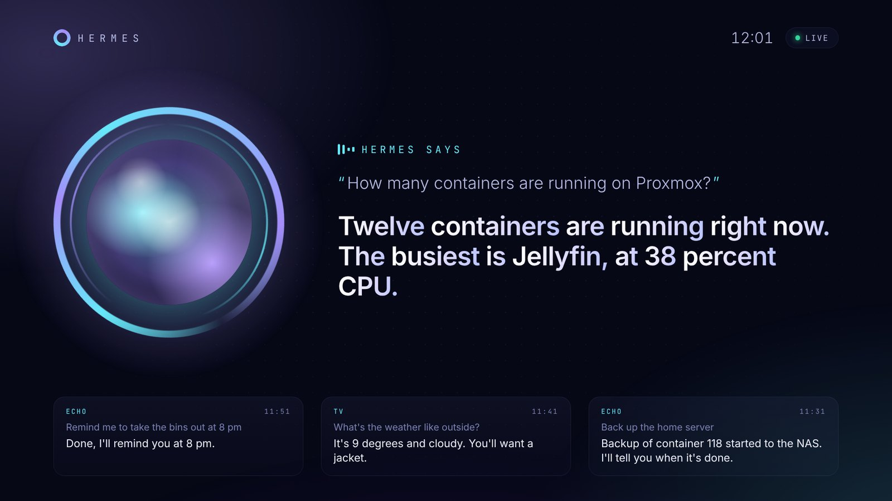

# Hermes on your TV

*[Version française](tv.fr.md)*

[](https://youtu.be/4oQY3ZKcexA)

▶️ [2-minute demo on YouTube](https://youtu.be/4oQY3ZKcexA)

Two ways to bring Hermes to the living-room TV. Both are served by the same `bridge.py`.

| | What it does | Needs |
|---|---|---|
| **TV screen** | A full-screen live view: Hermes listening, thinking, its answer word by word, the last exchanges, and a clock when idle. Shows the Echo's conversations too. | Any TV or browser |
| **Android TV app** | The same screen, plus **push-to-talk with the remote**: press OK (or the mic button), talk, Hermes answers through the TV speakers. | Android TV / Google TV (built in, or a Google TV box on HDMI) |
| **On a phone or tablet** | The same APK: a big **tap-to-talk** button, in portrait or landscape. | Android 6 or later |

## TV screen (any TV)

Open this address in the TV's browser (or a Fire TV / Chromecast browser, a tablet, a spare monitor):

```
http://<bridge IP>:8765/screen/
```

Options, added to the address:

| Option | Effect |
|---|---|
| `?lang=fr` / `?lang=en` | Interface language (default: the browser's) |
| `&wake=Computer` | The wake word shown on the idle screen |
| `&name=Simon` | "Good evening, Simon" |
| `&audio=1` | Also speak the replies on this screen (click once to allow sound) |
| `&demo=1` | Demo loop without a bridge, to try the look |
| `&avatar=medallion` | Avatar style: `orb` (default), `medallion`, `spectrum` or `hologram` (see below) |
| `&ink=black` | Avatar drawing in black ink on a light disc, instead of white ink |

The page only reads the live feed (`/events`), it can't send anything to Hermes.

## Your own animated avatar

Instead of the orb, the screen can show a portrait that blinks, moves its lips with the voice, grows when Hermes speaks and sends out sound waves. Three styles:

- **Medallion**: the portrait in a ringed disc, circular ripples on each syllable.
- **Spectrum**: a circular equaliser around the portrait; it spins while Hermes thinks.
- **Hologram**: a projected portrait with scan lines and a waveform; it glitches while Hermes thinks.

Any two-tone drawing works (white lines on a transparent background, or black on white). Turn it into vectors once:

```bash
pip install potracer scipy pillow numpy
python tools/make_avatar.py portrait.png --rig rig.json -o /opt/hermes-echo-bridge/avatar.json
```

`rig.json` says where the eyes and the lower lip are; the format is at the top of [`tools/make_avatar.py`](../tools/make_avatar.py). Then pick the style with `SCREEN_AVATAR` / `SCREEN_INK` in `.env`, with `?avatar=` in the address, or in the app's settings. No `avatar.json`: the orb is shown.

## Android TV app

### 1. Turn it on in the bridge

Add a shared secret to the bridge's `.env`, then restart it:

```bash
echo "TV_TOKEN=$(openssl rand -hex 16)" >> /opt/hermes-echo-bridge/.env
systemctl restart hermes-echo
grep TV_TOKEN /opt/hermes-echo-bridge/.env      # you'll type this once on the TV
```

Without `TV_TOKEN`, the bridge refuses the app: anyone on your Wi-Fi could otherwise talk to your Hermes, and Hermes may have access to your servers.

### 2. Install the APK

Download `hermes-tv-apk` from the latest successful run of the [Android TV app workflow](https://github.com/Naod6473/echo-hermes-bridge/actions/workflows/android.yml) (sign in to GitHub, then open the run and scroll to *Artifacts*). Then, either:

- **adb** from a computer (enable *Developer options* then *USB / network debugging* on the TV):
  ```bash
  adb connect <TV IP>
  adb install -r hermes-tv.apk
  ```
- or copy it to a USB stick / use the *Send files to TV* app, and open it with a file manager.

### 3. First start

The settings page opens: enter the bridge address (`192.168.1.64` is enough, the port defaults to 8765) and the token, press **Test**, then **Save**. You can also set everything from a computer:

```bash
adb shell am start -n io.github.naod6473.hermestv/.MainActivity --es bridge 192.168.1.64 --es token <TV_TOKEN>
```

### Using it

| Remote | Action |
|---|---|
| **OK** (or mic / search, when the TV gives it to apps) | Start talking. It stops by itself when you pause. Press again to send now. |
| Hold the button while talking | Release to send |
| **Back** while listening | Cancel |
| **D-pad down** | Settings (bridge, token, voice mode, avatar style, ink) |

### On a phone or tablet

Install the same APK (copy it to the phone and open it, allowing installs from that app). The page shows a big microphone button at the bottom:

| Touch | Action |
|---|---|
| **Tap** the button | Start talking. It stops by itself when you pause. Tap again to send now. |
| **Hold** it while talking | Release to send |
| **Cancel**, or Back | Drop it |
| **Gear**, top right | Settings |

The phone uses its own microphone, so the voice modes below matter less: *Auto* is fine.

### The remote's microphone

Remotes only open their microphone while their mic button is pressed, so **there is no always-on wake word on a TV**: it's push-to-talk. Keep the Echo for hands-free.

TVs don't all lend that microphone to apps the same way. The app has three modes (in its settings):

- **Auto** (default): records and sends the audio to the bridge's Whisper. If the TV only gives the app silence, it switches to the TV's own recogniser by itself.
- **Whisper (bridge)**: always your own server, nothing leaves your home.
- **Android**: the TV's recogniser (Google on Google TV), then the text goes to Hermes. Most reliable with the remote's mic.

On most Google TV models the mic button opens Google Assistant even inside the app. To make it open Hermes instead, remap it with a button-mapping app (e.g. *Button Mapper*) to *launch Hermes*: the app starts listening as soon as it opens.

### Building it yourself

```bash
cd android-tv
./gradlew assembleRelease        # needs JDK 17 and the Android SDK
```

The APK is signed with a key committed in `android-tv/app/hermes-tv.keystore`, so every build can update the one already on your TV. It only protects updates of this sideloaded app: if you publish your own fork, use your own key.

## API

For other clients (a Raspberry Pi with a button, a phone shortcut…):

| Route | |
|---|---|
| `GET /screen/` | The TV page |
| `GET /events` | Server-Sent Events: `hello` (with recent history), `listening`, `thinking` (`heard`), `reply` (`heard`, `text`, `audio`, `duration`), `idle`, `error` (`message`). Each has `id` (the turn) and `source` (`echo` or `tv`). |
| `POST /talk` | 16 kHz 16-bit mono PCM (or a WAV). Returns `heard`, `reply`, `audio` (path of the spoken reply), `duration`. Needs `Authorization: Bearer <TV_TOKEN>`. |
| `POST /ask` | `{"text": "..."}`. Same answer, same token. |
| `GET /health` | `{"ok", "echo", "tv", "language"}` |

The bridge can also run **without an Echo**: leave `ECHO_HOST` empty and set `TV_TOKEN`.
